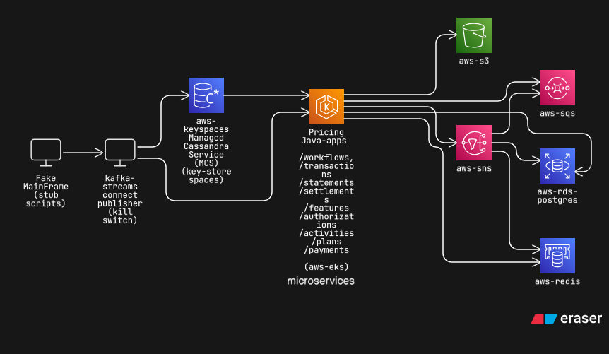
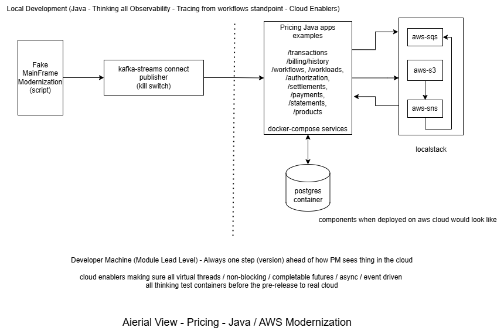
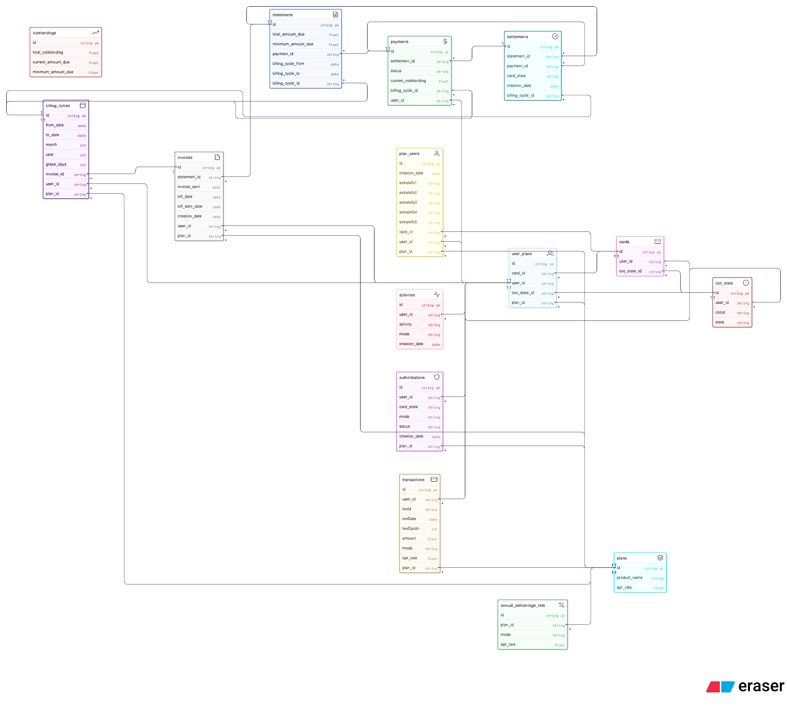

:doctype: book

= ENCELADUS AI - GENNIE
include::include.adoc[]

[chapter]
== Enceladus AI - Introduction to Gennie

Meeting Log:

|===
| Meeting Date | Attendees | Location

| 19/06/2026 | All Hands | client visits Hyderabad office
| 25/06/2026 | Teams | Charitha's session
|===

== Overview
This describes our understanding of enceladus behaviour as of now

[NOTE]
====
This is a scratch-book for Pricing Modernization with Java + AWS Cloud based on meeting minutes.

[square]
* Noting down card plans, card states, associated apr per plans, how is this working at present (flows), how big is the sizing we expecting in terms of volume
* Noting down what sort of improvement client is expecting in terms of error and precision,

* This document discusses Java-based handling of data volumes, projected system sizing, AWS architectural considerations, and planned test strategies, documentation for the project etc.

* How do we approach in terms of the adhering to the compliance(s) guidelines by US Federal authorities.
====

== Example Dataset (CSV Format)

Consider sample CSV transaction data for a user on average. (records can not cross more than 200-400 transactions a month if we presume)

include::scratchbook/_sample_dataset_csv.adoc[]

== Card State
include::scratchbook/_card_state.adoc[]

== Transaction Types
include::scratchbook/_transaction_types.adoc[]

== Test Volume Projection
include::scratchbook/_sizing_requirement.adoc[]

== Hypothetical example apps view (from SRE perspective)
How we may see it :-

== Hypothetical example apps view (from development perspective)
How we may see it :-

== Sampling
include::scratchbook/_samples.adoc[]

== What now?

Looking at entities we can foresee: (ignore the fieldset for now but the entity names and how one can link it based on flows mentioned  (settlements/cash/pricing/card_authorization))

[WARNING]
Below entity-relation does not involve any of card details and card-holder details but an correlation ids to be deal with. We leave that data with Mainframe CAM systems and build our assumptions on top of it.

Example:-

== Next ?
This section notes questions / doubts to be raised to onsite team for further clarifications

* Q1:
  . A
  . B

include::scratchbook/_questions.adoc[]

include::scratchbook/modernization-strategy.adoc[]

== Tests Strategies
include::scratchbook/_echosystem_tests.adoc[]

== APPENDIX
include::abbreviation.adoc[]

=== JVM Flags (Tuning)

[source,java]

include::scratchbook/_jvm_flags.adoc[]

== Insights
include::scratchbook/jvm-dump.adoc[]
